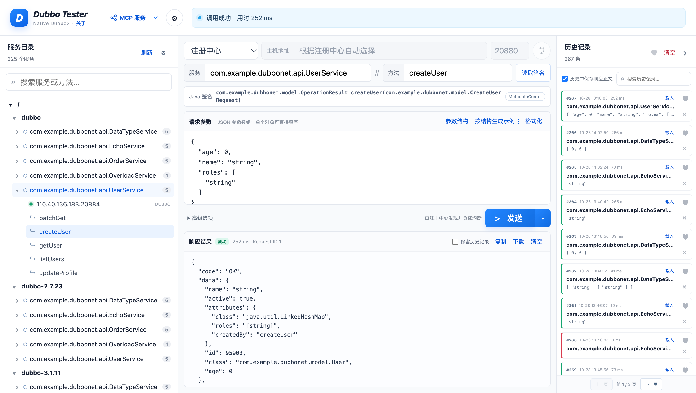
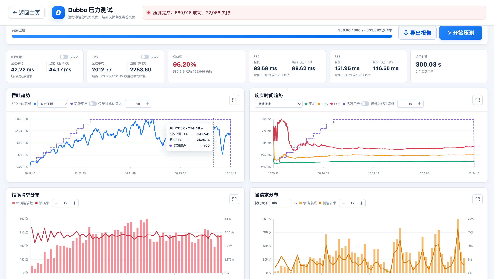
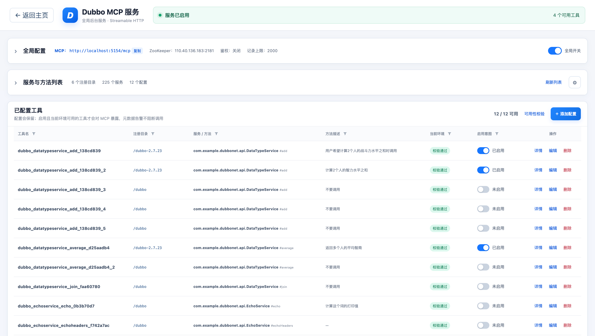
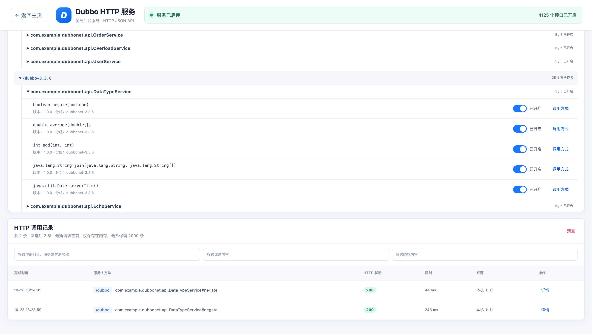

# DubboTester

**Dubbo 接口调试、快速压测、MCP 服务化与 HTTP 代理，一套工具完成。**

DubboTester 面向开发、测试和 AI 工具接入场景，无需安装 Java 环境、导入业务 JAR 或修改服务端代码，即可连接现有 Dubbo 服务。通过可视化服务目录选择方法、自动生成请求参数并发送调用，开箱即用，降低 Dubbo 接口调试的学习成本。

当前应用版本：**2.1.2**。

## 核心功能

### 1. 零门槛接口调试：选中方法，即可调用

- 无需业务工程或接口依赖，支持通过 ZooKeeper / Nacos 发现服务，也可直连 Provider。
- 自动读取方法签名、展示参数结构并生成可编辑的 JSON 示例，不必从零拼装复杂参数；已有输入和历史草稿不会被自动示例覆盖。
- 支持调用历史、收藏、请求恢复与响应查看，从选择接口到发送请求都在同一页面完成。

参数结构与自动示例由元数据中心提供；元数据不可用时，仍可手动填写精确 Java 参数类型和请求数据进行调用。



### 2. 快速压测：一键启动，指标与图表实时生成

- 从当前调试请求一键进入压测，无需另建脚本，即可快速验证目标接口的性能表现。
- 支持并发用户、时间或请求次数上限、阶梯启动与请求间隔等配置，实时展示 TPS、平均响应时间、成功率、P95 / P99 和趋势图。
- 支持业务断言、错误与慢请求分析，以及成功请求统计筛选；结束后可导出自包含 HTML 报告，离线查看和分享结果。



### 3. MCP 服务：让现有 Dubbo 接口成为 AI 工具

- 将 Dubbo 服务方法映射为 MCP 工具，配置描述、参数要求和启用范围后，即可供支持 MCP 的 AI 客户端调用。
- 无需改造业务服务或新增中间件，也能接入仍在使用历史 Dubbo 版本的服务；业务调用使用 Dubbo2 协议。
- 支持工具可用性校验、调用记录和可选 Bearer Token 鉴权；元数据缺失时，可使用已配置的精确参数类型继续调用。



### 4. HTTP 服务：直接暴露接口，方便临时联调

- 将 Dubbo 方法直接开放为 HTTP JSON 接口，使用 curl 或常见 HTTP 客户端即可调用，无需单独开发适配层。
- 支持按方法开启和关闭、生成调用示例、查看请求记录，适合跨语言联调、临时调试与快速验证。
- 提供可选 Bearer Token 鉴权；对外提供调用时应限制访问范围，并配合 HTTPS 使用。



## 获取与安装

DubboTester 同时支持 **Docker 镜像部署为 Web 服务**，以及 **Windows / macOS 桌面应用**。团队共享或服务器部署可选择 Docker，本机使用可选择桌面版；两种方式均无需另行安装 Java 环境。

### 方式一：Docker 镜像部署

镜像提供 `linux/amd64` 和 `linux/arm64` 架构，可从以下仓库获取：

- [Docker Hub：`lulianqi/dubbo-tester`](https://hub.docker.com/r/lulianqi/dubbo-tester)
- [GitHub Container Registry：`ghcr.io/lulianqi/dubbo-tester`](https://github.com/lulianqi/DubboTester/pkgs/container/dubbo-tester)

拉取镜像并启动（以下固定使用 `2.1.2`，也可将标签替换为 `latest`）：

```bash
docker pull lulianqi/dubbo-tester:2.1.2

docker run -d \
  --name dubbo-tester \
  --restart unless-stopped \
  -p 5154:8080 \
  -v dubbo-tester-data:/app/App_Data \
  lulianqi/dubbo-tester:2.1.2
```

启动后访问 `http://localhost:5154`；部署在服务器上时，使用 `http://<服务器地址>:5154`。首次打开后，在“连接与页面设置”中选择 ZooKeeper 或 Nacos，填写地址并点击“保存并刷新”，即可浏览服务并开始调试。

如需从 GHCR 获取，将上述命令中的镜像名替换为 `ghcr.io/lulianqi/dubbo-tester:2.1.2` 即可。

- 宿主机 `5154` 端口映射到容器内 `8080`；如端口已占用，可将 `-p 5154:8080` 改为其他空闲宿主机端口，例如 `-p 5155:8080`。
- 命名卷 `dubbo-tester-data` 用于持久化 MCP 和 HTTP 服务配置；连接与页面设置、调用历史及请求草稿保存在使用端的本地存储中。
- 容器必须能够访问注册中心和 Dubbo Provider 公布的地址；容器内的 `localhost` 指向容器自身，不是宿主机。
- 管理页面仅应向可信网络开放。MCP / HTTP 鉴权默认关闭，对外提供调用时请开启鉴权并使用 HTTPS。

### 方式二：桌面应用

[前往 GitHub Releases 下载最新版本](https://github.com/lulianqi/DubboTester/releases/latest)

下载对应平台的压缩包，解压后即可使用，无需安装 .NET SDK 或 Java 环境：

| 平台 | Release 资源 | 说明 |
| --- | --- | --- |
| Windows x64 | `DubboTester-Windows-x64-<版本号>.zip` | 自包含免安装版本，解压后运行 |
| macOS Intel / Apple Silicon | `DubboTester-macOS-universal-<版本号>.zip` | ad-hoc 签名的 Universal App，解压后运行 |
| 完整性校验 | `SHA256SUMS.txt` | 两个平台压缩包的 SHA-256 摘要 |

当前 macOS 桌面包仅使用本地 ad-hoc 签名，尚未进行 Developer ID 签名和 Apple 公证，首次运行可能需要在
“系统设置 → 隐私与安全性”中确认打开。

桌面版在本机提供 MCP / HTTP 服务时共用 `5154` 端口；如该端口已被其他程序占用，请先释放端口，再重启应用。

## 技术与调用方式

- .NET 10 / Blazor Interactive Server
- NuGet `DubboNet` **3.6.2**
- 支持 ZooKeeper 和 Nacos 注册中心，用于服务发现和元数据读取
- 业务请求通过 Dubbo2 TCP + Hessian2 `$invoke` 泛化调用发送，不使用 Telnet `invoke`
- 可选注册中心负载均衡调用，或指定 Provider 直连调用

`DubboNet` 在元数据中心不可用时可能在包内部用 Provider Telnet `ls -l` 读取一次方法签名；这只用于签名发现，不用于业务调用。使用界面中的精确 Java 参数类型即可跳过签名自动发现。

DubboNet 可读取元数据中心 `FullServiceDefinition.types`。当方法包含 POJO、集合、数组、枚举等结构型参数时，可以在“Java 签名”区域查看参数结构，并按该结构生成可编辑的请求 JSON 示例。类型结构仅由元数据中心提供；Telnet 签名来源不包含这部分信息。

“按结构生成示例”右侧的 `⋮` 可设置“如果用户数据为空，自动填充示例”，默认开启并保存在本地，用户主动关闭后会保留其选择。开启后会优先恢复当前方法/重载的已有参数草稿，仅在参数框为空、元数据中心签名可用且方法有参数时自动填充，不覆盖用户输入或已有草稿；无参数方法、仅 Telnet 签名或元数据读取失败时不会自动填充。

Dubbo 2.7.x 可能把 `String`、`Long`、`Integer` 等 JDK 类型的内部实现字段也写入 `properties`，例如 `String.value`、`String.hash`。DubboTester 会按字段声明类型识别这些标量/包装类型，不会将其内部字段当作业务请求字段；业务 POJO 自身声明的同名字段仍会正常保留。

## 从源码运行

开发环境需要安装 .NET 10 SDK：

```bash
dotnet restore src/apps/DubboTester.Web/DubboTester.csproj
dotnet run --project src/apps/DubboTester.Web/DubboTester.csproj
```

默认开发地址见 `Properties/launchSettings.json`。首次打开后，在设置里选择 ZooKeeper 或 Nacos、填写连接地址并刷新服务目录。

### 临时全局运行设置

在“连接与页面设置”弹窗中，连续点击标题 5 次（相邻点击间隔不超过 2 秒），可打开隐藏的全局运行设置，启用或关闭消费者注册。

消费者注册默认关闭，仅在当前应用进程中生效，不写入本地配置；刷新页面不重置，重启桌面应用或 Web/Docker 服务后恢复关闭。开关统一作用于主页、压测、MCP 和 HTTP 服务使用的注册中心客户端，应用名为 `DubboTester`，直连 Provider 不注册。Web 版同一服务进程中的所有用户共享此设置。

启用后，仍存活客户端调用过的接口会在后台注册；仅加载服务目录不会注册。关闭后在后台注销，不影响 RPC 调用。注册中心需要允许写入消费者信息，网络注册与注销可能有延迟。

### 浏览器本地存储

Web 版按数据性质使用混合存储，桌面版通过共享 UI 使用相同策略：

- `localStorage` 保存注册中心、超时、筛选项等连接与页面设置，便于启动时快速恢复少量配置。
- `IndexedDB` 保存调用历史（含响应正文和收藏状态）、各方法的请求参数草稿以及压力测试草稿，适合容量更大、更新更频繁的数据。
- 从旧版本升级时，原有 `localStorage` 调用历史和 `sessionStorage` 请求草稿会自动迁移到 `IndexedDB`，迁移成功后再清理旧数据。

浏览器存储按 Origin（协议、域名和端口）隔离；更换访问地址、使用隐私模式或清除站点数据时，看到的会是另一份或全新的本地数据。正式部署应保持固定访问地址，并避免把清理站点数据当作普通缓存清理操作。

## 项目结构

```text
src/
├── apps/
│   ├── DubboTester.Web/       # Web 与 Docker 启动入口
│   └── DubboTester.Desktop/   # Windows/macOS MAUI 桌面入口
└── shared/
    ├── DubboTester.Core/      # Dubbo、缓存、压测和 MCP 核心业务
    ├── DubboTester.Hosting/   # ASP.NET Core 与 MCP HTTP 宿主适配
    └── DubboTester.UI/        # Web 与桌面端共享 Razor UI
tests/
└── DubboTester.Tests/         # 核心逻辑测试
```

解决方案中按相同职责划分为 `Apps`、`Shared` 和 `Tests` 三个逻辑目录。
仓库根目录只保留解决方案、构建部署文件和项目级文档。

桌面版位于同一个解决方案和仓库中，但拥有独立入口。它通过 `BlazorWebView`
直接加载共享页面，并在进程内提供 `http://localhost:5154/mcp`。Web 与 Docker
继续只发布 `src/apps/DubboTester.Web/DubboTester.csproj`，不会包含 MAUI 桌面运行时。详细设计见
[`docs/desktop-architecture.md`](docs/desktop-architecture.md)。

### 桌面版开发运行

安装 .NET 10 Mac Catalyst workload 后，在 macOS 上运行：

```bash
sudo dotnet workload install maui-maccatalyst
DEVELOPER_DIR=/Applications/Xcode.app/Contents/Developer \
  dotnet build src/apps/DubboTester.Desktop/DubboTester.Desktop.csproj -c Debug
```

Debug 构建产物位于
`src/apps/DubboTester.Desktop/bin/Debug/net10.0-maccatalyst/<runtime>/Dubbo Tester.app`。
当前项目的 Debug 配置允许在旧版 Xcode 上进行迁移验证，并采用 `SdkOnly` 链接；正式
Release 打包仍会执行 Mac Catalyst workload 对 Xcode 版本的严格校验。

Windows 使用同一个项目，目标框架会自动切换为
`net10.0-windows10.0.19041.0`，构建机安装 `maui-windows` workload 即可。桌面配置
保存在操作系统应用数据目录，和 Web/Docker 的 `App_Data` 相互独立。

仓库中的 `Build desktop apps` GitHub Actions 工作流会在 GitHub Release 发布或手动触发时分别构建：

- 同时支持 Intel 与 Apple Silicon、经过架构校验和 ad-hoc 签名的 macOS `.app` 压缩包。
- 包含 .NET 与 Windows App SDK 运行组件的 Windows x64 免安装压缩包。

macOS 的 ad-hoc 签名产物用于开发验证。面向普通用户正式发布 macOS 版本时，仍需要 Apple Developer
证书、Developer ID 签名和公证；Windows 后续也可以在该工作流基础上增加证书签名或
MSIX 打包。

普通提交和手动运行产生的平台 ZIP 会作为单层 Actions artifact 保留 14 天，可以直接
下载和解压。在 GitHub 创建并发布 Release（标签基础版本须与桌面项目
`ApplicationDisplayVersion` 一致，例如 `2.1.2` 或 `v2.1.2`）后，工作流会自动汇总
两个平台的压缩包、生成 `SHA256SUMS.txt`，并上传到该 Release。Docker 发布工作流也会同时触发。
手动构建时可填写已有的 `release_tag` 上传到指定 Release；留空则仅生成 Actions artifact。

```bash
git tag -a 2.1.2 -m "DubboTester 2.1.2"
git push origin 2.1.2
gh release create 2.1.2 --verify-tag --title "DubboTester 2.1.2" --generate-notes
```

### 从源码构建 Docker 镜像

如需自行构建镜像，可在仓库根目录执行：

```bash
docker build -t dubbo-tester .
docker run --rm \
  -p 5154:8080 \
  -v dubbo-tester-data:/app/App_Data \
  --name dubbo-tester \
  dubbo-tester
```

启动后访问 `http://localhost:5154`。发布镜像的获取与部署方式见上方“获取与安装”。

## 请求参数约定

- 无参数：`[]` 或留空
- 单个对象参数：`{"id": 1}`
- 多个参数：`["abc", 123, true]`
- 单个 List 参数：使用外层参数数组，例如 `[[1, 2, 3]]`

直连 Provider 模式应填写精确 Java 参数类型；注册中心模式可由 DubboNet 从元数据解析，也可以显式填写以绕过元数据探测。

## 压力测试

点击“发送”右侧的小箭头，选择“压力测试”进入独立页面，沿用当前调试请求作为初始配置，也可在压测页独立修改。支持按“并发用户数 N × 每用户发送次数 M”运行，或在指定时长内持续发送请求；每个用户顺序发送，所有用户并发执行。支持配置注册中心负载均衡模式，以及全部用户共享、每用户独立、每 10 / 20 用户共享的 TCP 复用模式。压测不会把单次请求结果写入调用历史或数据库。

请求 JSON 模板支持以下内置变量，用户序号和发送序号均从 1 开始：

- `{{user}}` / `{{userIndex}}`：当前用户序号
- `{{iteration}}` / `{{iterationIndex}}`：当前用户的发送序号
- `{{randomInt}}` / `{{randomInt:1:1000}}`：随机整数
- `{{randomString}}` / `{{randomString:12}}`：随机字符串
- `{{guid}}`：无连字符 GUID
- `{{timestamp}}`：`yyyy-MM-dd HH:mm:ss` 当前时间
- `{{unixTimestamp}}`：Unix 毫秒时间戳

页面实时显示完成进度、平均响应时间、TPS、成功率、P95、P99、吞吐和响应时间趋势。超过 20,000 个已完成请求时，运行中的 P95/P99 使用最多 20,000 个随机样本降低统计开销；压测结束后会使用全部请求耗时精确重算最终分位数。

响应时间、TPS 卡片以及吞吐趋势、响应时间趋势图分别提供“仅统计成功请求”开关，默认关闭；打开后仅切换对应卡片或图表的统计口径，不改变压测请求和成功率统计。

负载配置还支持启动与请求节奏控制：

- 用户启动间隔（ms）：同一批内相邻用户的启动时间差；默认 `0`，表示同批用户同时启动。
- 阶梯启动间隔（s）与阶梯用户数：按指定间隔分批启动用户；间隔为 `0` 时不启用阶梯启动。
- 请求间隔：同一用户相邻两次请求之间的等待时间；默认 `0`，表示连续发送。

趋势图支持鼠标悬停查看对应采样时刻的即时 TPS、平均响应、P95 和 P99。运行明细默认只显示失败请求，也可切换为显示全部请求；明细按每页 100 条分页。默认不保存请求和响应正文，开启“记录请求&响应”后会在本次页面内存中保存参数化后的请求和完整响应，并提供独立列、悬浮提示及详情展开查看，不会写入历史记录或数据库。请求与响应正文采用约 100 MB 的内存预算，超过后先清理最旧的成功请求正文；只有失败请求正文自身也超过预算时才清理最旧的失败正文，基础明细和统计不会被删除。

请求模板下方可以配置可选的业务断言。断言支持响应正文包含指定内容，以及通过 JSONPath（例如 `$.code`、`$.data.items[0].id`）读取字段后判断存在、不存在、等于、不等于、包含或数值大小；多个条件可以按 AND 或 OR 组合。Dubbo 调用成功但业务断言不满足时，该请求仍会计为压测失败。

压测运行期间配置不可编辑，请勿刷新页面；运行结果仅保存在当前页面。完成或停止后可点击“导出报告”，保存一个自包含 HTML 文件。报告包含实际压测配置、核心指标、可交互趋势图和按“全部 / 仅失败”选择导出的轻量级运行明细，可离线打开；请求与响应正文仅包含当前内存中仍保留的内容。

## 远程 MCP 服务

从主页顶部进入“MCP 服务”独立页面，选择并配置 ZooKeeper 或 Nacos 后扫描服务和方法。每个 Java 方法签名会映射为一个独立 MCP 工具；启用前必须填写工具描述、适用/触发条件和参数要求，输入 Schema 会根据元数据中的 Java 参数结构生成。全局开关与方法开关都启用后，远程 Agent 才能在 `POST /mcp` 的 `tools/list` 中看到并调用该工具。

MCP 使用官方 .NET SDK 的 Streamable HTTP 传输。新建配置的鉴权默认关闭，已有配置保持原值；启用鉴权后，客户端连接时需要设置 `Authorization: Bearer <访问令牌>`，令牌可在管理页复制或重新生成。对外访问时建议启用鉴权并使用 HTTPS。配置持久化到 `App_Data/mcp-config.json`（已从 Git 忽略），应用重启时自动恢复。调用记录只保存在进程内存中，可在页面设置保留 10–5000 条，默认 5000 条。

工具可用性校验不强制依赖元数据中心。已确认当前注册中心存在匹配的 Provider 和方法、但元数据缺失或签名读取失败时，会显示“元数据告警（可用）”，继续使用工具中已保存的 Java 参数类型、版本和分组进行显式调用；请确认这些配置正确。服务或方法不存在、没有可用 Provider，以及已读取到的精确签名不匹配，仍属于不可用状态。已有的校验失败状态可点击“可用性校验”重新检查。

远程访问时还需要让应用监听可达网卡并通过 HTTPS/反向代理暴露 `/mcp`；不要把管理页面或 Bearer 令牌公开给不受信任的网络。

## Dubbo HTTP 服务

主页“MCP 服务”右侧的下拉菜单提供“HTTP 服务”和“压力测试”入口。HTTP 服务管理页为 `/http-service`，配置独立于 MCP，支持 ZooKeeper / Nacos、注册目录自动扫描和独立元数据中心。保存配置后会读取服务与精确方法签名，直接在列表中打开方法开关即可，无需填写工具描述；全局开关和方法开关同时开启才允许调用。无法读取签名或没有匹配 Provider 的方法不可开启。

“全部开启”会开放当前及后续刷新发现的所有可用方法；关闭此配置会关闭全部方法。处于全部开启模式时，单独关闭一个方法会转为逐项控制，保留其他当前方法。方法开关仍按完整服务身份分别保存，避免重载或不同版本、分组互相影响。

点击“调用方式”可复制包含实际地址、鉴权头和示例参数的 curl。接口为 `POST /api/dubbo/{注册目录}/{服务全名}/{方法名}`，例如 `/api/dubbo/dubbo/com.example.dubbonet.api.EchoService/echoBytes`。多级目录保留层级（如 `/team/dubbo`），实际注册目录为 `/` 时省略目录段；特殊字符按 URL 编码。旧的哈希 ID 调用地址不再支持。

路径匹配到唯一方法时可直接调用；同一路径存在多个版本、分组或重载时，必须用查询参数 `version`、`group`、`parameterTypes` 消除歧义，否则返回 HTTP 409，不会按开启状态或参数值自动选择另一个方法。`parameterTypes` 按 Java 参数顺序用逗号分隔，例如 `?version=1.0.0&group=demo&parameterTypes=java.lang.String,int`；显式空值表示无版本、无分组或无参数（`parameterTypes=`），省略参数表示不限制该维度。存在歧义时，页面生成的地址和 curl 会自动补齐这些参数。

请求使用 `Content-Type: application/json`：

```json
{
  "arguments": [1, 2],
  "attachments": {"traceId": "example"}
}
```

`arguments` 必须按 Java 参数顺序填写；无参数方法使用 `[]`，单个数组参数使用 `[[1, 2]]`。`attachments` 可省略，仅支持字符串键值对，不能覆盖服务、版本或分组等路由参数。请求正文上限为 1 MB。响应包含 `success`、`data`、`error` 和 `elapsedMs`；成功为 HTTP 200，参数错误 400、鉴权失败 401、接口未开启或不存在 404、不支持的 HTTP 方法 405、路由有歧义 409、正文过大 413、内容类型不支持 415、Dubbo 调用失败 502、全局服务关闭 503。

全局开关默认关闭，新建 HTTP 配置的 Bearer Token 鉴权默认关闭，已有配置保持原值；对外访问时建议启用鉴权并使用 HTTPS，仅将调用路径暴露给可信客户端，不要公开管理页面。网页端使用当前站点地址；桌面端共用本机 5154 监听端口，仍仅允许本机访问。配置持久化到 `App_Data/http-config.json`，调用记录仅在内存中保存，可按服务/方法、请求和响应筛选，每页 50 条；过长记录会截断并标注，不影响实际 HTTP 响应。
